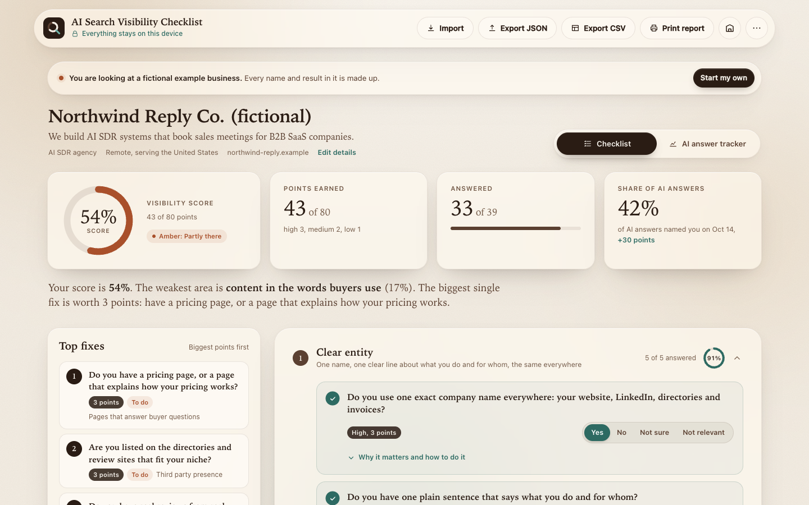
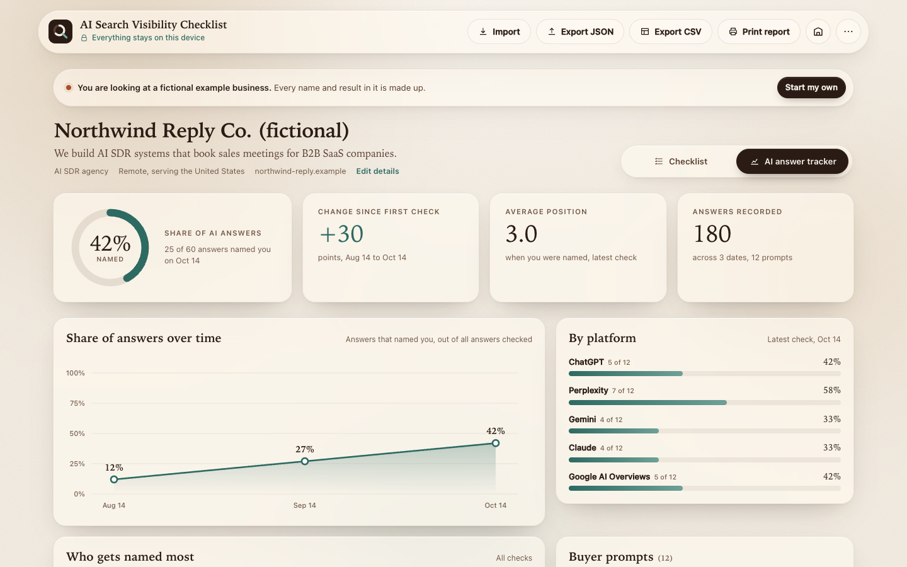
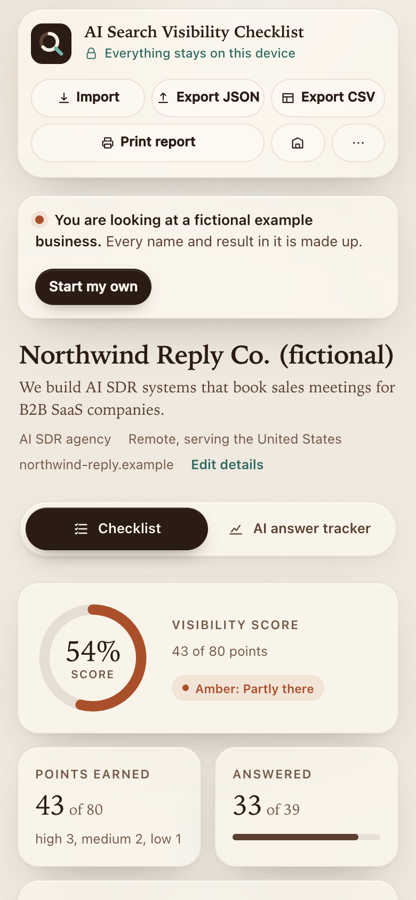

# AI Search Visibility Checklist

Help your business get discovered across ChatGPT, Perplexity, Gemini, Claude and Google AI Overviews: a 39 point checklist with a
visibility score and your top fixes, plus a tracker for the buyer questions people ask AI tools.

## Quick start with Claude Code

Give Claude this repo link and say: set up the AI Search Visibility Checklist for me, open the app, and check how visible my business is.

Repo: https://github.com/onittindwani-ai/ai-search-visibility-checklist

Claude asks you simple questions, saves your answers on your computer, scores them, explains your top 3 fixes and drafts an
"about us" fact sheet and FAQ answers from your own facts.

## 3 ways to use it

| Way | How to open it | Guide |
| --- | --- | --- |
| **The app** | Double click `app/index.html`, or run `python3 tools/serve.py` (opens http://localhost:8767) | [docs/01-THE-APP.md](docs/01-THE-APP.md) |
| **The documents** | Print [CHECKLIST.md](CHECKLIST.md) and [PROMPT-LIBRARY.md](PROMPT-LIBRARY.md) | [docs/02-THE-CHECKLIST-AND-PROMPTS.md](docs/02-THE-CHECKLIST-AND-PROMPTS.md) |
| **Claude Code** | Say "audit how visible my business is in AI search", or use `/visibility-audit` and `/visibility-report` | [docs/03-WITH-CLAUDE-CODE.md](docs/03-WITH-CLAUDE-CODE.md) |

All three use the same checklist and the same scoring rules. No install, no account. The app makes no network calls.

## What is inside

1. **The checklist**: 39 items in 7 sections (clear entity, website basics for AI crawlers, pages that answer buyer questions, third
   party presence, proof and freshness, content in the words buyers use, measure). Each item has why it matters and how to do it.
   Answer Yes, No, Not sure or Not relevant, and get a visibility score (green, amber or red) and the top fixes in order.
2. **The AI answer tracker**: a library of 38 example buyer prompts in 6 niches that you edit into your own list. Ask each prompt on
   ChatGPT, Perplexity, Gemini, Claude and Google AI Overviews, then record if you were named, your position and which competitors
   were named. The app shows your share of answers over time and who gets named most. It never calls any AI for you.
3. **A website check**: `python3 tools/site_check.py https://your-site.com` checks your own site for AI crawler blocks in
   robots.txt, Organization (or LocalBusiness or SoftwareApplication) structured data, title, meta description, H1, linked pricing,
   about and FAQ pages, and llms.txt. [docs/05-CHECK-YOUR-WEBSITE.md](docs/05-CHECK-YOUR-WEBSITE.md)
4. **Exports**: JSON (backup, import on another device), CSV (checklist or tracker) and a one page printable report.

## Screenshots

Real screenshots of the app with the fictional sample business, on desktop and phone width: [screenshots/](screenshots/)







More screenshots:

- [A checklist section open, with why it matters and how to do it](screenshots/desktop-section-open.png)
- [Recording what the AI said, per platform and date](screenshots/desktop-tracker-record-results.png)
- [A button while it works](screenshots/desktop-button-processing.png) and [when it is done, with a toast](screenshots/desktop-button-done-and-toast.png)
- [Phone, a section open](screenshots/phone-section-open.png) and [phone, the tracker](screenshots/phone-tracker.png)

## The example (fictional)

Northwind Reply Co. is a made up AI SDR agency. It has answered 33 of 39 items and scores 54 percent (amber): strong on clear entity
and website basics, weak on third party presence and content in the words buyers use. Its top fixes are a pricing page, directory
listings and real reviews. Over 3 monthly checks of 12 buyer prompts on 5 platforms, the share of answers that named it went from 12
to 27 to 42 percent. Every name and number in the sample is invented.

## Use the command line tool

```
python3 tools/visibility.py check      # check your data/business.json for mistakes
python3 tools/visibility.py report     # score, sections, top fixes, tracker results
python3 tools/visibility.py json       # machine readable output
python3 tools/visibility.py csv        # one row per checklist item (add --tracker for tracked answers)
python3 tools/visibility.py report --file data/sample-business.json
```

Python 3.9 or newer, standard library only. How the score works: [docs/04-HOW-THE-SCORE-WORKS.md](docs/04-HOW-THE-SCORE-WORKS.md).

## Privacy

Everything stays on your device. The app and `tools/visibility.py` make no network calls and send nothing anywhere. The only tool
that touches the network is `tools/site_check.py`, and only when you run it with your own website address: it fetches your home page,
`/robots.txt` and `/llms.txt`, nothing else. More in [docs/SECURITY.md](docs/SECURITY.md).

## Good to know

- No tool can guarantee that an AI will mention or recommend your business, and AI answers change often. This kit makes you easier
  to find and understand, and shows you the trend. Read [docs/LIMITS-AND-HONESTY.md](docs/LIMITS-AND-HONESTY.md).
- llms.txt is on the list as optional, with unproven impact.
- The sample business, its results and every competitor name are fictional.

## Docs

- [Start here](docs/00-START-HERE.md)
- [The app](docs/01-THE-APP.md)
- [The checklist and prompts](docs/02-THE-CHECKLIST-AND-PROMPTS.md)
- [With Claude Code](docs/03-WITH-CLAUDE-CODE.md)
- [How the score works](docs/04-HOW-THE-SCORE-WORKS.md)
- [Check your website](docs/05-CHECK-YOUR-WEBSITE.md)
- [Limits and honesty](docs/LIMITS-AND-HONESTY.md)
- [Security](docs/SECURITY.md)

## Run the tests

```
python3 -m unittest discover tests
node --test tests/engine.test.mjs
python3 tests/check_kit.py
```

The tests never use the network: the website checker is tested with local fixture pages and a fake fetch.

## Licence

MIT, Copyright (c) 2026 Onit Tindwani. See [LICENSE](LICENSE). Version 1.0.0, see [CHANGELOG.md](CHANGELOG.md).
